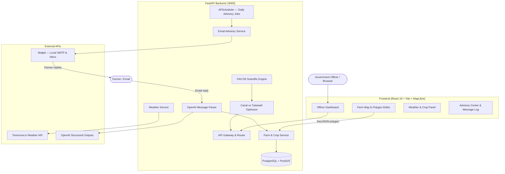

# AquaProof Pakistan 🌾💧

> **AI-Powered Agricultural Advisory & Irrigation Management Platform**  
> *Government-operated farm intelligence — built for the Hackathon by a 5-member engineering & research team.*

[](https://fastapi.tiangolo.com)
[](https://www.python.org)
[](https://react.dev)
[](https://www.typescriptlang.org)
[](https://tailwindcss.com)
[](https://vitejs.dev)
[](https://postgis.net/)
[](https://platform.openai.com)
[](https://www.docker.com)
[](LICENSE)

---

## 📖 Table of Contents

- [Overview](#-overview)
- [The Problem & Value Proposition](#-the-problem--value-proposition)
- [Key Features](#-key-features)
- [System Architecture](#-system-architecture)
- [Team Roster & Ownership](#-team-roster--ownership)
- [Repository Structure](#-repository-structure)
- [Getting Started](#-getting-started)
  - [Prerequisites](#prerequisites)
  - [Backend Setup (FastAPI)](#backend-setup-fastapi)
  - [Frontend Setup (React + Vite)](#frontend-setup-react--vite)
  - [Email Testing with Mailpit](#email-testing-with-mailpit)
- [API Reference](#-api-reference)
- [Testing & Quality Assurance](#-testing--quality-assurance)
- [License](#-license)

---

## ⚡ Overview

**Current status.** AquaProof supports geographic field registration, crop seasons, scheduled email, field-level weather, and irrigation scenarios. Farm Map opens over Pakistan in MapLibre GL JS with the OpenFreeMap Liberty vector basemap. Weather and irrigation use the saved field's PostGIS representative point.

**AquaProof Pakistan** gives government agricultural officers a digital record of every registered farm and uses location-specific weather data, FAO-56 scientific simulation, and AI communication to deliver timely, personalized irrigation and crop-management guidance — even to farmers who don't use smartphones.

Officers manage farms through a central web dashboard. Farmers receive recommendations via email (simulating SMS for the prototype). Every advisory is generated from that farm's actual polygon boundary, crop stage, soil profile, and local weather — not generic templates.

---

## 🌾 The Problem & Value Proposition

- **Pakistan's Water Crisis:** Agriculture consumes over **90% of Pakistan's freshwater** while irrigation efficiency remains critically low due to poor timing, over-watering, and lack of farm-specific guidance.
- **No Farm-Level Intelligence:** Existing advisory systems issue blanket district-level recommendations. A Punjab wheat farmer and a KPK maize farmer receive the same guidance despite having entirely different water sources, rainfall, and crop stages.
- **The AquaProof Solution:**
  1. **Persistent Farm Registry:** Every participating farm has a permanent digital profile — geographic boundary, crop history, water sources, and irrigation records — stored and queryable by location.
  2. **Scientific Irrigation Engine:** Implements the internationally validated FAO-56 methodology to calculate exactly how much water each crop needs at each growth stage, accounting for local evapotranspiration and soil conditions.
  3. **Canal vs. Tubewell Optimizer:** Weighs the farmer's registered canal turn schedule against tubewell pumping costs and rainfall forecasts to recommend the most cost-effective irrigation strategy.
  4. **AI-Powered Communication:** Farmers reply in English, Urdu, or Roman Urdu. OpenAI extracts structured data from natural language replies, updates farm records, and generates a recalculated advisory — all automatically.

---

## 🎯 Key Features

### 1. 🗺️ Interactive Farm Mapping & Permanent Registration
- Government officers draw exact farm boundaries by clicking points on a live map (MapLibre GL JS + Terra Draw).
- Field area is calculated server-side from the saved geographic polygon via PostGIS geography functions.
- Each farmer can have multiple fields; each field maintains an independent crop history.
- The API accepts GeoJSON polygons and stores valid WGS84 boundaries in PostGIS with a spatial index.

### 2. 🌱 Farmer-Specific Crop Monitoring
- System records crop type, variety, planting date, soil profile, and irrigation source per field.
- Crop growth stage is estimated from planting date and the PI-Advisor crop calendar. Local weather drives daily crop water demand.
- Full seasonal history is preserved after harvest. Officers can review past crop rotations and irrigation events without overwriting older records.

### 3. 💧 Scientific Irrigation & Smart Decision Engine
- Implements **FAO-56 crop-water balance** methodology (adapted from PI-Advisor) — the same standard used by international agricultural organizations.
- Answers four questions for every farm: how much water is needed, when to irrigate, whether to use canal or tubewell, and what happens if the forecast changes.
- The SciPy optimizer compares no irrigation, canal only, tubewell only, and mixed supply where configured. It prioritizes modeled crop stress and then pumping cost.
- Water volume formula: `Volume (m³) = Depth (mm) × Area (m²) ÷ 1000`

### 4. 📧 Email Advisories and Reply Review

- Officers approve emails for immediate or scheduled SMTP delivery. APScheduler processes the delivery queue.
- A configured OpenAI-compatible endpoint can extract irrigation source, duration, and date from Urdu, Roman Urdu, or English replies.
- Officers approve complete parsed replies before they appear in the field history. Automatic recommendations depend on the planned scientific engine.
- **Mailpit** captures outgoing email for local testing.

### 5. 🏛️ Government Officer Dashboard
- Clean, authoritative dashboard showing all registered farms, their current crop stage, last advisory, next recommended action, and full conversation history.
- Current conditions, forecasts, and agricultural weather layers per field from **Tomorrow.io**, with backup providers.
- Advisory center with one-click send, approval flow, and message log.
- Irrigation cost comparison chart (Recharts) — canal vs. tubewell, with estimated pumping expense.

---

## 🏗️ System Architecture



---

## Planned open-source integrations

These integrations are planned for a functional government-operated irrigation management platform. Inspect each project's documentation, source code, and license before implementation.

1. **PI-Advisor** — Use its irrigation algorithms, soil-water balance calculations, and crop water requirement models as the scientific foundation. [PI-Advisor](https://github.com/wateraccounting/PI-Advisor)
2. **MapLibre GL JS, OpenFreeMap, and Terra Draw** provide the vector basemap and boundary editor. Open-Meteo provides place search. Turf estimates draft area and PostGIS calculates saved area. [OpenFreeMap](https://openfreemap.org/quick_start/) · [Terra Draw](https://github.com/JamesLMilner/terra-draw)
3. **PostgreSQL and PostGIS** — Persist farm boundaries, farmer profiles, irrigation schedules, and historical records. [PostgreSQL](https://github.com/postgres/postgres) · [PostGIS](https://github.com/postgis/postgis)
4. **Tomorrow.io** provides field forecasts, current conditions, and plan-dependent agricultural and historical weather data. [Tomorrow.io API docs](https://docs.tomorrow.io/reference/welcome)
5. **SciPy** — Develop Pakistan-specific Warabandi scheduling, canal water allocation, tubewell cost optimization, and what-if simulations. [SciPy](https://github.com/scipy/scipy)
6. **FastAPI** — Implement backend APIs using a modular architecture. [FastAPI](https://github.com/fastapi/fastapi)
7. **Mailpit and SMTP/IMAP** — Implement two-way email communication to simulate farmer SMS interactions. [Mailpit](https://github.com/axllent/mailpit)

### Future implementation instructions

- Inspect the existing AquaProof codebase before making changes, and verify repository URLs and licenses.
- Reuse relevant implementations and algorithms where appropriate. Install libraries directly instead of cloning entire repositories unnecessarily.
- Preserve the existing UI and PRD requirements. Keep dependencies minimal and avoid paid APIs.
- Implement each integration sequentially and test it before proceeding.
- Use real data where available and maintain proper open-source attribution.
- Ensure the modules work together as one functional government-operated irrigation management platform, and continue implementation until all integrations are functional.

## 👥 Team Roster & Ownership

| Member | Role | Key Responsibilities |
| :--- | :--- | :--- |
| **Asfand** | **Backend Lead, Mapping & AI Integration** | FastAPI setup, PostgreSQL/PostGIS schema and migrations, farm/field/crop APIs, MapLibre mapping and Terra Draw boundary editing, OpenAI message parsing, SMTP email service, APScheduler advisory jobs, Docker Compose, branch integration, and frontend/backend consistency for these features. |
| **Hasham** | **Scientific Engine & Weather** | FAO-56 crop-water balance module (adapted from PI-Advisor), weather integration, crop stage estimation, canal vs. tubewell cost optimizer, synthetic demo dataset. |
| **Hamza** | **Frontend & UI/UX** | React dashboard, weather panel, irrigation chart (Recharts), advisory center UI, conversation panel, full backend API integration. |
| **Talal** | **Research, Docs & Presentation** | Problem research (Pakistani canal water practices, FAO-56 methodology), README, architecture diagrams, API guide, competition slides, live demo script. |
| **Sarim** | **QA, Testing & Validation** | Pytest unit & integration tests, farm boundary & area validation, simulation regression tests against PI-Advisor reference fixtures, email delivery & AI parsing tests, bug tracker. |

---

## 📁 Repository Structure

The tree below describes the target layout. The implemented backend uses app/registry.py, app/communications.py, and numbered SQL migrations.

```text
aquaproof-pakistan/
│
├── frontend/              # React + Vite + TypeScript
│   ├── public/          # Branding and demo satellite imagery
│   ├── src/
│   │   ├── app/         # Dashboard shell, navigation, and state
│   │   ├── pages/       # Dashboard views
│   │   ├── features/    # Map and registration workflows
│   │   ├── components/  # Shared UI components
│   │   ├── domain/      # Demo data and irrigation calculations
│   │   ├── styles/      # Global dashboard styles
│   │   └── main.tsx     # React entry point
│   ├── package.json
│   ├── pnpm-lock.yaml
│   └── vite.config.ts
│
├── backend/                         # Python 3.12+ / FastAPI
│   ├── app/
│   │   ├── main.py                  # FastAPI entry point & CORS
│   │   ├── database.py              # SQLAlchemy engine & session factory
│   │   │
│   │   ├── models/                  # SQLAlchemy ORM models (10 entities)
│   │   ├── schemas/                 # Pydantic request/response schemas
│   │   │
│   │   ├── routes/
│   │   │   ├── farmers.py           # /api/farmers
│   │   │   ├── fields.py            # /api/fields
│   │   │   ├── crops.py             # /api/crop-seasons
│   │   │   ├── weather.py           # /api/fields/{id}/weather
│   │   │   ├── irrigation.py        # /api/fields/{id}/simulate & /optimize
│   │   │   ├── advisories.py        # /api/advisories
│   │   │   └── messages.py          # /api/messages/inbound
│   │   │
│   │   ├── services/
│   │   │   ├── weather_service.py   # Backend weather integration
│   │   │   ├── canal_service.py     # Canal turn schedule management
│   │   │   ├── irrigation_engine.py # FAO-56 soil-water balance wrapper
│   │   │   ├── optimizer.py         # Canal vs tubewell SciPy optimizer
│   │   │   ├── ai_service.py        # OpenAI structured message parsing
│   │   │   ├── advisory_service.py  # Advisory generation & scheduling
│   │   │   └── email_service.py     # SMTP send + Mailpit integration
│   │   │
│   │   ├── scientific/
│   │   │   └── fao56/               # FAO-56 crop-water balance module
│   │   │       ├── __init__.py
│   │   │       ├── crop_coefficients.py
│   │   │       ├── water_balance.py
│   │   │       └── crop_parameters.json
│   │   │
│   │   └── worker.py                # APScheduler background jobs
│   │
│   ├── migrations/                  # Alembic migration scripts
│   ├── tests/                       # Pytest unit & integration tests
│   └── requirements.txt
│
├── data/
│   ├── crop_parameters/             # FAO-56 crop coefficient tables
│   ├── reference_weather/           # NASA POWER historical reference data
│   └── demo/                        # Synthetic Punjab wheat farm demo dataset
│
├── docs/
│   ├── architecture.md
│   ├── api-contract.md
│   ├── er-diagram.md
│   └── research-sources.md
│
├── docker-compose.yml
├── .env.example
└── README.md
```

---

## 🚀 Getting Started

### Prerequisites

- **Frontend** requires Node.js 20.19+ on the 20.x line or Node.js 22.12+, and pnpm 10.34.3.
- **Python**: v3.12 or higher
- **Docker & Docker Compose**: v2.0+
- Docker Compose provides **PostgreSQL and PostGIS** for the persistent database.

---

### Backend Setup (FastAPI)

Set `TOMORROW_API_KEY` in the repository-root `.env` file or the environment that runs Compose. Compose passes it to the backend. Then start the dashboard, API, PostgreSQL with PostGIS, and Mailpit from the repository root.

```bash
docker compose up -d --build
```

Compose applies SQL migrations on startup and stores records in a named volume. Open the [connected dashboard](http://localhost:8080), [API documentation](http://localhost:8000/docs), or [service health](http://localhost:8000/health).

### Frontend Setup (React + Vite)

Use Vite for local frontend development with the AquaProof backend running on port 8000. In PowerShell:

```powershell
cd frontend
pnpm install --frozen-lockfile
pnpm dev
```

Vite proxies `/api` to the local backend. Set `VITE_API_URL` to override the backend address for a separate deployment. For a native development backend, start Uvicorn from `backend` with `--env-file ../.env` or set the variables in its process environment.

### Farm map and boundary drawing

- The Liberty vector basemap uses OpenStreetMap data and requires no API key. OpenStreetMap raster tiles provide a fallback if the vector style fails to load. Set `VITE_MAP_TILES` at build time to use an approved OpenStreetMap raster tile service directly. Attribution appears on the map. [OpenFreeMap](https://openfreemap.org/quick_start/) · [OpenStreetMap tile usage policy](https://operations.osmfoundation.org/policies/tiles/)
- Satellite and Hybrid are available when the deployment supplies an authorized satellite basemap. Set `VITE_SATELLITE_TILES` to a browser-accessible HTTPS XYZ template with `{z}`, `{x}`, and `{y}`. Supply `VITE_SATELLITE_ATTRIBUTION`, `VITE_SATELLITE_LICENSE_URL`, and `VITE_SATELLITE_MAX_ZOOM` for the source. Hybrid adds roads and place labels from the Liberty style.
- Set `VITE_SATELLITE_DIGITIZATION_AUTHORIZED=true` after verifying in writing that the imagery covers the intended Pakistani farm areas and that its terms permit display, boundary tracing, and storage and export of the resulting polygons. Use a tile endpoint that allows your dashboard origin. These build values are public. Any provider that requires private credentials must be served through an authorized tile gateway.
- Use verified farm boundary information when placing vertices. Map search accepts place names and decimal coordinates in latitude, longitude order. Saved polygons reference farmers and store a PostGIS point inside each polygon. The point updates automatically when the boundary changes.
- The draft area is a Turf estimate. Saved area is taken from PostGIS geography and shown in acres, kanals, marlas, and hectares using 8 kanals and 160 marlas per acre. Irrigation colours reflect the saved supply configuration and today's canal turn. Removing a field archives it and retains its history.

### Field weather and irrigation

- In Farm Map, enter a place name or decimal coordinates in `latitude, longitude` order. After tracing is authorized, draw the parcel and link it to a farmer. A farmer's region is a label for filtering records. Weather and irrigation use the point inside the parcel stored in PostGIS.
- Weather & Canal Data shows Tomorrow.io current conditions plus hourly and daily forecasts. Search a place name or decimal coordinates, or select a registered field to see its saved canal schedule alongside the forecast. The daily table includes rainfall, peak precipitation probability, and reference evapotranspiration (ET₀). [Tomorrow.io forecast](https://docs.tomorrow.io/reference/weather-forecast) · [Core weather fields](https://docs.tomorrow.io/reference/data-layers-core)
- Registered fields also support on-demand recent weather, archive dates, and hourly soil moisture, soil temperature, and solar irradiance. Availability depends on the key's access and data coverage. Archive queries accept up to 31 UTC days, ending at least seven days ago, and can consume archive tokens. [Recent history](https://docs.tomorrow.io/reference/weather-recent-history) · [Historical API](https://docs.tomorrow.io/reference/historical-overview) · [Soil layers](https://docs.tomorrow.io/reference/land) · [Solar layers](https://docs.tomorrow.io/reference/solar)
- Each weather reload makes a new provider request. If Tomorrow.io is unavailable or returns unusable data, Open-Meteo backs up the forecast, current conditions, recent modeled weather, and soil and solar data. NASA POWER backs up the historical archive. Results show the provider and retrieval time. Provider values follow each provider's update schedule. [Open-Meteo forecast API](https://open-meteo.com/en/docs) · [NASA POWER daily API](https://power.larc.nasa.gov/docs/services/api/temporal/daily/)
- AquaProof API responses use `Cache-Control: no-store`. Weather panels, searches, and conversation history have refresh controls. The profile menu can also refresh the workspace registry.
- In Crop Monitoring, save the crop and planting date. In Irrigation Intelligence, enter the field's measured root-zone and surface water parameters, current depletion and application efficiency. Add the farmer's first Warabandi turn date, recurrence, duration and flow, or the tubewell flow, daily hours and pumping cost, as appropriate.
- Run a baseline or change rainfall, canal timing or pumping cost. Root-zone calculations use the PI-Advisor crop calendar and an FAO-56 balance with estimated surface evaporation. The plan uses consecutive forecast days with usable rainfall and ET₀ and reports the provider. Canal capacity comes from the entered roster and flow, and irrigation windows are modeled at daily resolution.
- In **Irrigation Intelligence → PI-Advisor irrigation planner**, run the baseline and select a forecast day to accept, skip, adjust or reopen an irrigation decision. Each revision stays with the crop season in PostgreSQL. The calculation fixes the saved volumes for reviewed days and recomputes the remaining forecast, including depletion, pumping cost and supply conflicts. Decisions record intended irrigation. Updates to measured depletion and records of completed irrigation are separate workflows. [PI-Advisor workflow](https://github.com/wateraccounting/PI-Advisor#usage)
- **Explain this plan with AI** uses the configured OpenAI-compatible API. It sends the modeled plan and weather context without farmer contact details. The explanation stays separate from the calculated quantities and costs.

To add two clearly labeled synthetic registry examples in Sindh and Balochistan, run:

```bash
docker compose exec api python -m app.science.demo
```

The examples use live weather for their sample coordinates.

### Email Testing with Mailpit

For the OpenRouter-assisted workflow, use the setup below. The manual email workflow continues to work with the assistant disabled.

The Advisory Center queues an officer-approved email immediately or for a selected time. APScheduler sends due messages through SMTP and records delivery status. The default Compose configuration delivers locally to [Mailpit](http://localhost:8025).

Record a farmer reply against a sent advisory in the UI, or submit it through `POST /api/messages/inbound`. For a mailbox that receives real replies, configure `SMTP_HOST`, `SMTP_PORT`, `SMTP_FROM`, and any required SMTP credentials. Set `SMTP_STARTTLS=1` for a provider that requires STARTTLS. Set `IMAP_HOST`, `IMAP_PORT`, `IMAP_USERNAME`, and `IMAP_PASSWORD` for mailbox polling. Replies imported from IMAP are matched to a sent advisory using the email thread and farmer address.

To parse replies, set `OPENAI_BASE_URL` to an OpenAI-compatible endpoint ending in `/v1` and set `OPENAI_MODEL`. Set `OPENAI_API_KEY` if the provider requires authentication. A compatible local model can handle parsing without a paid API. Complete parsed records go into field history when an officer approves them.

The local API and Mailpit UI bind to loopback. This development setup has no officer authentication and is intended for local evaluation with test records.

### Agricultural assistant

The assistant defaults to disabled. Apply the database migrations before enabling it. Set the following values in the backend environment or in the Git-ignored Compose `.env`:

| Setting | Purpose |
| --- | --- |
| `ASSISTANT_ENABLED=1` | Enable the assistant and officer authentication for the registry, weather, irrigation and communications APIs. |
| `ASSISTANT_OFFICER_TOKEN` | An independently generated secret of at least 32 characters. Enter it in the dashboard's officer sign-in form. Use a TLS-protected, officer-authenticated deployment and restrict access to the API and mailbox. |
| `ASSISTANT_REPLY_SECRET` | A different randomly generated secret of at least 32 characters. Keep it stable across workers. Rotating it invalidates existing reply credentials. |
| `OPENROUTER_API_KEY` and `OPENROUTER_MODEL` | A backend key and a multilingual model that supports tool calling and strict structured outputs. |
| `OPENROUTER_APPROVED_PROVIDERS` | Comma-separated provider identifiers approved for the deployment. Routing requires zero data retention, denies data collection, and only falls back within this list. [OpenRouter routing documentation](https://openrouter.ai/docs/guides/routing/provider-selection) |
| `SMTP_*` and `IMAP_*` | The existing delivery settings and a dedicated assistant inbox. Use SMTP STARTTLS and IMAP TLS for real mail. Mailpit can capture outgoing email locally. An IMAP mailbox is required to exercise automated replies. |

Open **AI Advisory Center**, select a field, choose English, Urdu or Roman Urdu, and send mailbox verification. The farmer replies with the one-time line delivered to the registered mailbox. Future farmer messages require a fresh signed reply line tied to an email sent to that mailbox. A verified reply of `STOP` unsubscribes the farmer. Enrollment starts automatic advice for the farmer's active fields. The old unauthenticated IMAP importer and external reply parser stay off while the assistant is enabled.

The persistent job queue schedules one daily evaluation per active, verified field after 07:00 Pakistan time and checks for material weather changes in three-hour windows starting at 10:00. New crop, irrigation-setting and accepted observation records also queue rechecks. Evidence includes the provider, retrieval time, optimizer results and rainfall sensitivity. Soil-water measurements used for advice require an officer-entered timestamp within 36 hours. Missing or stale measurements prompt a request for updated information. The optimizer provides gross volume and the pump runtime uses that volume divided by measured discharge, with no second efficiency adjustment. Canal advice uses the registered turn duration and day. The existing roster does not record an exact start time.

The model can classify and propose an observation, but outgoing automated text comes from validated templates and numerical recommendations come from the optimizer. Officers review weather hazards, crop stress, rainfall-sensitive plans and unsupported questions. Reported observations update the record only after officer approval. A transport error before SMTP transmission can retry automatically. Unknown delivery outcomes require officer review to avoid sending a duplicate. The dashboard shows superseded advice, queued or failed work, evidence and provider-reported costs.

The model receives only the verified farmer's scoped context. Parcel coordinates are used locally for weather. By default, the external model receives area and boundary metadata. Enable `ASSISTANT_SHARE_PRECISE_GEOMETRY=1` only if your approved privacy policy permits exact coordinates and suitably small polygon rings to leave the backend. The farmer reader role has no write grants. The migration account needs permission to create and grant that role.

---

## 🔌 API Reference

| Method | Endpoint | Description |
| :--- | :--- | :--- |
| `GET` | `/health` | Service status check |
| `POST` | `/api/farmers` | Register a new farmer |
| `GET` | `/api/farmers` | List all registered farmers |
| `GET` | `/api/farmers/{id}` | Retrieve farmer profile |
| `GET` | `/api/registry` | List farmers and fields in one snapshot |
| `POST` | `/api/registrations` | Register a farmer and field in one transaction |
| `POST` | `/api/fields?farmer_id={id}` | Save farm boundary (GeoJSON) + attributes |
| `GET` | `/api/fields/{id}` | Retrieve field with GeoJSON boundary |
| `PATCH` | `/api/fields/{id}` | Update registered field |
| `POST` | `/api/crop-seasons?field_id={id}` | Start a new crop cycle for a field |
| `GET` | `/api/locations?q={place}` | Search for map locations by name |
| `DELETE` | `/api/fields/{id}` | Archive the field and retain its history |
| `GET` | `/api/weather/search?q={location}` | Hourly and daily forecast for a name or coordinates |
| `GET` | `/api/weather/current?latitude={lat}&longitude={lon}` | Current conditions for a searched location |
| `GET` | `/api/fields/{id}/weather` | Hourly and daily forecast with registered canal capacity |
| `GET` | `/api/fields/{id}/weather/current` | Current conditions for the field |
| `GET` | `/api/fields/{id}/weather/recent` | Recent weather for the field |
| `GET` | `/api/fields/{id}/weather/history` | Daily historical archive for a date range |
| `GET` | `/api/fields/{id}/weather/agriculture` | Hourly soil and solar outlook for the field |
| `GET / PUT` | `/api/fields/{id}/irrigation-settings` | Read or save soil water and supply inputs |
| `POST` | `/api/fields/{id}/simulate` | Run a field-specific irrigation scenario |
| `GET` | `/api/crop-library` | List available PI-Advisor crop calendars |
| `PUT` | `/api/fields/{id}/irrigation-decisions/{date}` | Save a reviewed decision against the current crop season and recalculate the baseline |
| `POST` | `/api/fields/{id}/optimize` | Compare irrigation strategies, pumping costs, and crop stress |
| `POST` | `/api/fields/{id}/intelligence` | Explain a calculated plan using the configured model |
| `GET` | `/api/fields/{id}/advisories` | Retrieve advisory history for a field |
| `POST` | `/api/advisories` | Approve and queue an advisory email |
| `POST` | `/api/advisories/{id}/send` | Retry a failed delivery |
| `POST` | `/api/messages/inbound` | Record a farmer reply for parsing |
| `POST` | `/api/messages/{id}/approve` | Add a complete parsed reply to field history |

Interactive documentation available at `http://localhost:8000/docs`.

---

## 🧪 Testing & Quality Assurance

### Verify connected workflows

Use test records. Register a farmer and draw a field in the connected dashboard, then reload and check the saved boundary and area. Edit the polygon and confirm that the area updates. Use Crop Monitoring to start a season and check the previous crop on the farmer profile. Approve a test advisory, confirm its delivery in Mailpit, then record a reply and review the conversation.

With the backend dependencies installed, run the irrigation model tests from `backend/` with `python -m unittest discover -s tests -v`.

### Frontend Production Build

Check source formatting and TypeScript, then build the frontend.

```bash
cd frontend
pnpm format:check
pnpm typecheck
pnpm build
```

---

## 📄 License

This project is licensed under the MIT License — see the [LICENSE](LICENSE) file for details.

The frontend ships license notices for [MapLibre GL JS](frontend/public/licenses/maplibre-gl.txt), [Terra Draw, including its MapLibre adapter](frontend/public/licenses/terra-draw.txt), and [Turf](frontend/public/licenses/turf.txt). Basemap data attribution appears on the map.

The crop coefficients and stage lengths come from PI-Advisor and the soil water calculation adapts its published method. [Pinned PI-Advisor source](https://github.com/wateraccounting/PI-Advisor/tree/18197955f9ad2f74da0a73de240ff448fa67c8dd) · [MIT license notice](backend/app/science/PI-Advisor-LICENSE.txt)

---

<p align="center">
  <b>AquaProof Pakistan</b> • Every farm. Every drop. Every decision. 🌾
</p>
